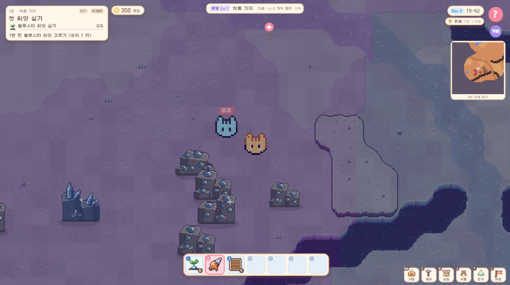

# Space Cat Farm

26년 캡스톤 디자인 졸업작품. 고양이들이 사는 2D 힐링 개척 게임임.

고향 별 자원이 바닥나서 고양이들이 새 행성으로 이주하기로 함. 플레이어는 선발대로 먼저 내려가서 불모지를 정화하고 농사짓고 기계로 자동화함. 이주 셔틀로 고양이 가족들을 불러오면서 문명을 7단계까지 키우면 큰 이주선이 내려옴.

PC(Windows)랑 안드로이드 둘 다 같은 빌드로 돌아가고 최대 4명까지 같이 할 수 있음.

## 주요 기능

- 농사: 작물 14종. 날씨, 바이옴, 특수 토양에 따라 자라는 속도랑 수확량이 달라짐
- 자동화: 드릴, 자동 파종기 · 수확기, 컨베이어, 제련소, 전력망, 화물 레일
- 이주 셔틀 · 주민: 셔틀에 짐 실어 보내면 주민이 이주해 옴. 주민이랑 대화하고 선물 주면 친밀도 보상 있음
- 진행: 문명 7단계, 퀘스트 6장 82개, 연구 11트랙, 전초기지 3곳. 여정 창(L)에서 할 일 확인 가능
- 경제: 씨앗 사고 작물 · 요리 팔아서 코인 벌고, 꾸미기 · 공방 · 마을 축제 · 이주 좌석에 씀. 광석이랑 주괴는 못 사고팖
- AI 조수 코코: "철 광석 10개 캐 줘" 같은 말을 알아듣고 채굴, 수확, 심기, 제작, 판매 등 13가지 명령으로 직접 해 줌
- 협동 멀티: 호스트가 참가 코드 만들고 친구가 코드 입력해서 들어옴 (최대 4명)
- 전시 데모: 메인 메뉴 [전시 데모] 누르면 약 7분 동안 성장 과정을 자동으로 보여 주고 계속 반복함. 저장은 안 됨

## 조작

| 키 | 동작 |
| --- | --- |
| WASD | 이동 |
| 좌클릭 | 설치 · 심기 · 캐기 · 수확 |
| 우클릭 꾹 | 해체 |
| F | 넣기 · 수확 · 이야기 |
| 1~7, Q / E, 휠 | 핫바 |
| Ctrl + 휠 | 확대 · 축소 |
| G | 격자 |
| Tab / C / B / T | 가방 · 제작 · 상점 · 연구 |
| J / L / M | 이주 셔틀 · 여정 · 큰 지도 |
| K / Enter | 코코 대화 · 채팅 |
| Esc / P | 창 닫기 · 메뉴 |

패드(Xbox 호환)도 됨. 왼쪽 스틱 이동, 오른쪽 스틱 조준, RT 사용, LT 꾹 해체, A 열기 · 넣기. 안드로이드는 터치 버튼으로 하고 패드 연결하면 패드 화면으로 바뀜. 전체 조작은 게임 안 도움말(?)에 있음.

## 개발 환경

| 항목 | 내용 |
| --- | --- |
| 엔진 | Unity 6000.2.7f2, URP 2D 17.2 |
| 언어 | C# |
| 입력 | Input System 1.14 |
| 멀티 | Netcode for GameObjects 2.7, Unity Relay · Authentication |
| 플랫폼 | Windows (D3D11), Android |

## 실행

1. Unity Hub에서 6000.2.7f2로 프로젝트 열기
2. `Assets/Scenes/MainMenu.unity` 열고 Play
3. 빌드는 File > Build Profiles에서 Windows / Android 선택. Windows는 D3D11 고정임

코코 대화는 API 키가 있어야 함. 키는 레포에 안 올렸으니 환경 변수 `WISH_API_KEY`나 `Assets/Scripts/Debug_field/env` 파일에 직접 넣어야 함. 키 없어도 게임은 되고 코코 대화만 안 됨.

멀티는 Unity Gaming Services 프로젝트 연결 필요함.

## 폴더

| 경로 | 내용 |
| --- | --- |
| `Assets/Scenes` | MainMenu, InGame, Lab(실험용) |
| `Assets/Scripts/Debug_field` | 게임 코드 대부분. 기능별로 폴더 나눠 둠 |
| `Assets/Scripts/Debug_field/Editor` | 퀘스트 생성, 그림 반영, 모바일 미리보기 같은 에디터 도구 |
| `Assets/Editor` | 테스트, 자동 플레이 봇 |
| `Assets/Graphics` | 스프라이트, 타일 |

## 팀

| 이름 | 역할 |
| --- | --- |
| 문영민 | 팀장, 기획, 시스템 설계, 그래픽 · 사운드 · 세이브 |
| 이창형 | 게임플레이 · UI/UX 개발, 최적화, 빌드 |

## 라이선스

MIT ([LICENSE](LICENSE))
